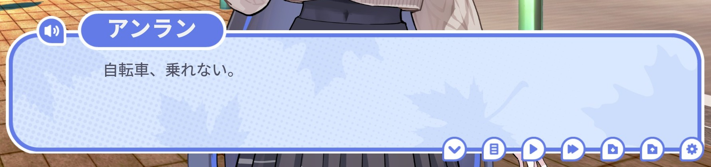
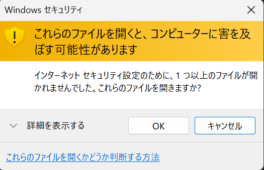
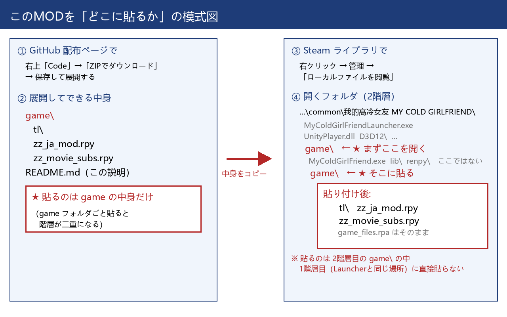
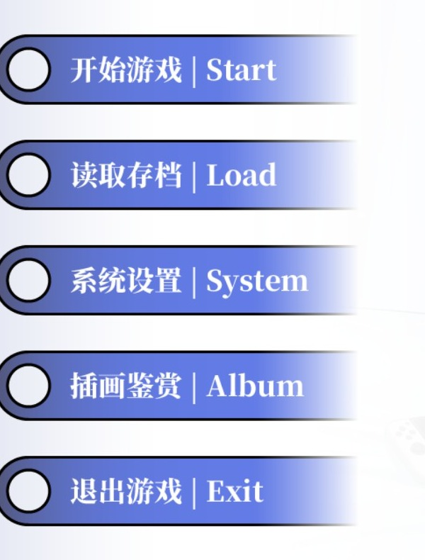
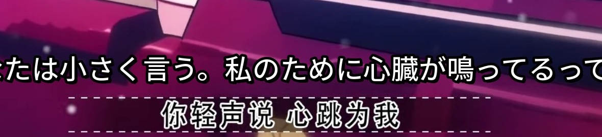

# 我的高冷女友 MY COLD GIRLFRIEND 日本語化MOD

Steam 版 **『我的高冷女友 MY COLD GIRLFRIEND』**（Steam appid 3765590／制作: SuiKa Soft・発行: LoveStoryProject）の
**本文と画面の文字を日本語で読めるようにする非公式MOD**です。

ゲームフォルダに翻訳ファイルを置くだけで適用でき、**削除すれば完全に元に戻ります**。
ゲーム本体のファイルは一切書き換えません（実行基盤・インストーラ・プログラムは不要・不使用）。

| 項目 | 内容 |
|---|---|
| 対応 | Steam 版『我的高冷女友 MY COLD GIRLFRIEND』（Ren'Py 8.5.0） |
| 導入 | このページにある `game` フォルダの中身を、ゲームの `game\game` フォルダへコピーするだけ |
| 実行基盤 | **不要**（Ren'Py 標準の翻訳ファイル＋表示設定ファイルの追加だけで動きます） |
| ゲーム内言語 | 変更しなくて構いません。MOD 側で表示言語を `japanese` に固定します |
| 元に戻す | 追加したファイルを削除するだけ |
| 翻訳範囲 | 本編 **2,816 行**（原文 49,008 字）＋ 翻訳したUI文字列 **422 件**（**テキストで描画されている部分のみ**。画像のボタン・見出しは日本語化されません） |
| ファイル | 追加9個・合計 **689,433 B（約0.7 MB）** |
| 版 | **v1.8**（2026-11-21） |

適用すると、本文は次のように日本語で表示されます（名札はカタカナ表記）。



---

## ダウンロード

**方法1（かんたん）** — このページ右上の **`Code` → `ZIPでダウンロード`**（GitHub がリポジトリ全体のZIPを自動生成します）

**方法2（ファイルだけ欲しい場合）** — 上の **`game`** フォルダを開き、入っているファイルを各 **ダウンロードボタン**（Download raw file）で取得

> ZIPを開くと `game` フォルダと README が入っています。**導入で必要なのは `game` フォルダの中身だけ**です。

### ZIP を開くときの警告について

Windows では、ダウンロードした ZIP を開くときに次の警告が出ることがあります。



これは**インターネットからダウンロードしたファイルに Windows が付ける印**によるもので、中身が危険という意味ではありません。
本MODの中身は**テキストファイル9個だけ**です（`.exe` やインストーラなどのプログラムは一切含みません）。

- そのまま **「保持する」／「OK」** を選んで解凍して構いません。一度解凍すれば、そのあとは警告は出ません。

---

## 使い方（3ステップ）

どこに貼るかの全体図です（**右側の `game\game\` まで入って、その中に貼ります**）。



### 1. ゲームのフォルダを開く

Steam ライブラリで『我的高冷女友 MY COLD GIRLFRIEND』を右クリック → **管理** → **ローカルファイルを閲覧**

### 2. `game` の中身を、そこにコピーする

開いたフォルダの中の **`game`** を開き、さらにその中の **`game`** を開きます
（`game_files.rpa` が入っている場所が差し替え先です）。

そこへ、ダウンロードした **`game` フォルダの中身**をコピーします（`tl` フォルダ・`zz_ja_mod.rpy`・`zz_movie_subs.rpy`）。

```
（ゲームの）game\game\
 ├─ game_files.rpa          … 変更していません
 ├─ tl\japanese\            … 追加（翻訳データ。既存の tl と統合されます）
 │   ├─ common.rpy
 │   └─ rpy\scripts\script.rpy   … ほか rpy 配下に5個
 ├─ zz_ja_mod.rpy           … 追加（表示言語・フォント・名札の設定）
 └─ zz_movie_subs.rpy       … 追加（冒頭動画の日本語字幕）
```

`tl` フォルダは既存フォルダと統合されます。上書き確認が出たら「はい」を選んでください。

### 3. ゲームを起動する

そのまま起動すれば日本語で表示されます。Steam の言語設定を変える必要はありません。

---

## 元に戻す

ゲームフォルダから次に**追加したファイルを削除**するだけです。元の中国語表示に戻ります。

- `tl\japanese` フォルダ
- `zz_ja_mod.rpy`
- `zz_movie_subs.rpy`（冒頭動画の日本語字幕だけを外したい場合。本文の日本語化は残ります）

`.rpyc` などゲームが自動生成するファイルが残っていることがあります。残っていても動作には影響しませんが、
完全に元どおりにしたい場合は同じ名前の `.rpyc` も削除してください。

> Steam の「ゲームファイルの整合性を確認」を実行しても、**本MODで追加したファイルは消えません**
> （`tl\japanese` と `zz_ja_mod.rpy` を実機で確認済み。Steam が管理するファイルだけ直し、追加したファイルは削除しません）。
> 戻すときは上で挙げたファイルを自分で削除してください。

---

## ⚠ セーブデータについて（影響なし）

- セーブデータの**形式・保存先は変更していません**（翻訳ファイルと表示設定の追加のみで、ゲーム側のデータに触れていません）。
- 実機でセーブ画面・ロード画面・セーブ／ロード動作を確認しています。
- MOD を入れっぱなしでプレイしても、セーブを理由に問題が起きることはありませんでした。

---

## 何が変わる／変わらない

**日本語になるもの**

- 本編の本文・地の文・モノローグ（**2,816 行**）
- 名札（ルージョン / アンラン / ワンズミン / チェン教授 ほか、カタカナ表記）
- **冒頭動画の歌詞字幕**（約86秒のOP動画。動画に焼き込まれた中国語の**直上に日本語の歌詞を重ねます**。動画ファイル自体は変更していません）
- **テキストとして描画されている画面の文字列**（翻訳登録 **422 件** ＝ ゲーム独自の文字 68 ／ Ren'Py 標準のメッセージ・案内文 316 ／ 本作に組み込まれた画像編集ツールの文字 37 ／ ゲーム名 1）

**日本語にならないもの（仕様です）**

- **画像として描かれた文字** — タイトルロゴ、メインメニューのボタン（`开始游戏 | Start` など）、
  設定・セーブ／ロード・履歴画面の縦書き見出し（`设置 | System`・`存档 | Save`）、
  画面下部の `上 | Last`・`下 | Next`、設定画面の小ボタン
  （**このゲームで目に見える UI 文字の大半は画像**です。上の「422 件」はテキスト描画分の数えです）
- **実績名**（Steam 側に登録されている名前。本MODは変更していません）
- **音声は中国語のまま**です。本作の音声は台詞に合わせて自動で鳴る仕組みで、音声ファイルは **635個**
  （本編2,816行のうち一部に付いています）。日本語化するのは**文字だけ**です
- 立ち絵・背景・BGM・動画の映像
- エンディングの動画（約98秒）にはもともと焼き込まれた歌詞字幕がないため、変化しません

**メインメニューのボタンは、このように原文のままです。**



**設定画面の見出し・ボタンも同じです**（画像のため、MOD を入れても表示は変わりません）。


### 冒頭動画の歌詞字幕について

冒頭に流れる歌の動画（約86秒）の字幕は**動画に焼き込まれています**。
本MODは映像を伏せる帯を使わず、**焼き込みの中国語のちょうど直上に日本語の歌詞を重ねます**
（動画ファイル自体は一切変更していません。焼き込みの中国語もそのまま残ります）。



エンディングの動画（約98秒）にはもともと焼き込まれた歌詞字幕がないため、変化しません。

### 画像内の中国語など、原文のままの部分を読みたいとき（任意）

1. 該当シーンで **F12**（Steam のスクリーンショット）または **Win + Shift + S**（範囲切り取り）
2. 撮った画像を画像翻訳にかける
   - スマホの **Google レンズ**
   - **PowerToys の「テキスト抽出」**（Win + Shift + T）
   - Windows 11 の「Snipping Tool」→「テキストのアクション」
3. 固有名詞は本MODの表記と揺れることがあるので、読み替えて読む

---

## 実績について

Steam 実績は**通常どおり解除されます**。
解除の仕組みはゲーム本体のファイル側に書かれていて（`ACH001`〜`ACH010` の**10個**を確認しています）、
本MODはそれらのファイルを変更しておらず、追加ファイルだけで動作します。
実績の**解除条件**（本体スクリプト内の `unlock_ach()` の呼び出し10箇所）も、実績の**名前**（Steam 側の登録）も、本MODは一切変更していません。

---

## 翻訳・表示の品質について（既知の限界）

翻訳は **LLM に原文（中国語）から直接日本語訳を生成させた**もので、機械翻訳エンジンは通していません。
生成後は、次の確認を行っています。

- 原文と訳文の行対応の突き合わせ（脱落・取り違えがないかの確認）
- 日本語としての読み確認（口調・自然さ・呼び方の揺れ）
- 機械検査（中国語の語の残留、表記のゆれ、同じ句の重複、句読点、Ren'Py のタグ崩れ）

不自然な箇所は都度直しています。ただし機械検査と人手の確認では取り切れない残り方をする場合があります。
次のような限界があります。

- ことわざ・詩的な比喩・言い回しの取り違えが完全に抜けていない箇所があるかもしれません
- 感情の強さ（叫び・語気の上げ方）は、原文の記号に完全には合わせていません
- 中国の大学が舞台の設定用語（授業名・サークル・寮など）は、説明を足さずそのままにしている箇所があります
- 名札はカタカナ、本文の人名は漢字（路正・安冉）のままです。呼称の対応は次のとおりです
  - 路正（ルージョン）＝主人公・語り手 ／ 安冉（アンラン）＝ヒロイン ／ 王子明（ワンズミン）＝級友 ／ 陳教授（チェン教授）

**表示（フォント）**：ゲーム本体に入っている書体（DreamHanSans）の日本語面を使って表示しています。**書体を追加で入れることはしていません**。
日本語かなの欠字はなく（実測で文字化け・豆腐は確認されていません）、仮名と漢字の大きさのバランスも自然な範囲です。

誤訳や不自然な表現を見つけた場合は、**該当場面（チャプターや前後のセリフ）を添えて Issue で報告**いただけると助かります。次回更新で反映します。

---

## 権利・免責

- 本MODは**非公式のファンメイド翻訳**です。SuiKa Soft / LoveStoryProject および Valve・Steam とは無関係です。
- **ゲーム本体のファイル（画像・音声・動画・実行ファイル）は一切含んでいません・再配布していません。**
  追加9個の中身は翻訳データと表示設定のみです（Ren'Py の標準的な翻訳ファイルの形を取るため、
  該当箇所を特定する目的で原文の一文がコメント行として入っています）。
- ゲームの著作権は **SuiKa Soft / LoveStoryProject** に帰属します。
- **本MODの再配布・販売は禁止**します（他人に配る形での改変・翻訳の二次利用もご遠慮ください）。
  ただし**ご自身で使うための改変**（表記の変更・自分で読むための編集）は妨げません。
- 自己責任でご利用ください。本MODの使用によって生じた損害について作者は責任を負いません。
- 掲載しているゲーム画面は、説明のための**引用**です（© SuiKa Soft / LoveStoryProject）。

---

## 権利者様へ

本MODは非公式のファンメイド翻訳であり、原作の権利を侵害する意図は一切ありません。
ゲーム本体のファイルは含んでおらず、翻訳したテキストのみを配布しています。

権利者の方で、**本MODの公開に問題があるとお考えの場合はご連絡ください。**

- GitHub の Issue：このページの **Issues** タブ
- または本リポジトリの管理者アカウントへのご連絡

ご連絡をいただいた場合は、内容を確認のうえ、**異議なく速やかに公開を停止・削除**します。

---

## クレジット

- 原作：**SuiKa Soft / LoveStoryProject**『我的高冷女友 MY COLD GIRLFRIEND』
- 翻訳：個人によるファンメイド翻訳（LLM で翻訳し、機械検査と原文との突き合わせで点検）

---

## 更新履歴

- **v1.8**（2026-11-21）初公開。本編2,816行と画面の文字422件の日本語化、冒頭動画の日本語字幕（焼き込み字幕の直上）。